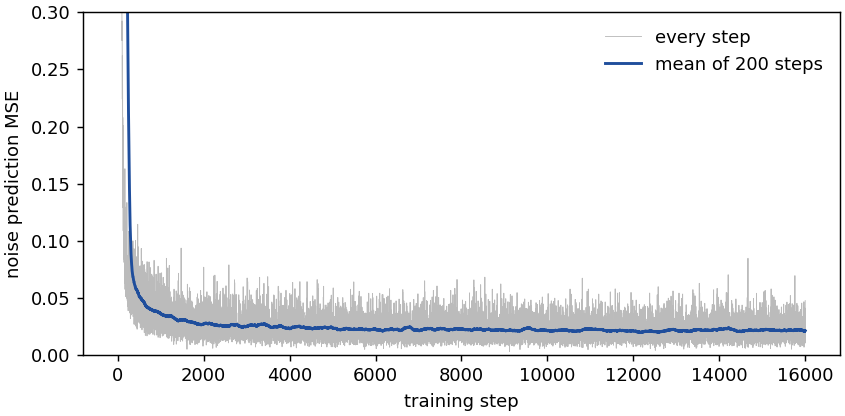
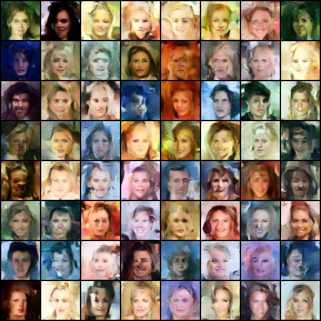
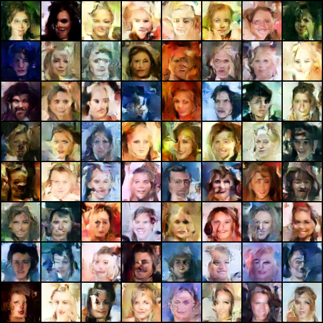
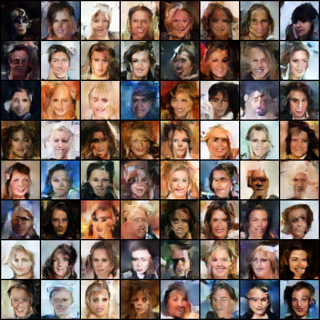

# ddpm-from-scratch

Denoising diffusion probabilistic models in PyTorch, written from the equations: a UNet with self-attention, the DDPM and DDIM samplers, a training loop on Hugging Face Accelerate, and sampling and FID scripts. Trained here on CelebA at 64 x 64.

## Contents

- [What is in the repository](#what-is-in-the-repository)
- [Installation](#installation)
- [Usage](#usage)
- [Results](#results)
- [Development](#development)
- [References](#references)

## What is in the repository

```
src/
├── model.py      # UNet (residual blocks, self-attention, sinusoidal time embedding), build_model
├── sampler.py    # linear beta schedule, forward noising, DDPM reverse step, DDIM step
├── train.py      # Accelerate training loop (AdamW, cosine schedule, checkpoints, sample images)
├── sample.py     # generate a grid of images from a checkpoint with DDPM or DDIM
├── evaluate.py   # FID of generated images against real ones (torch-fidelity)
└── utils.py      # datasets (torchvision CelebA, Hugging Face, image folder), plotting
tests/            # model shapes, sampler maths, a tiny end-to-end training run
results/          # numbers and images of the Results section
```

- **Sampler.** `Sampler.add_noise` implements $x_t = \sqrt{\bar\alpha_t}\,x_0 + \sqrt{1-\bar\alpha_t}\,\epsilon$, `remove_noise` the ancestral DDPM step and `ddim_step` the DDIM step on a strided sub-sequence of the 1000 timesteps.
- **Clipping.** Both steps can clip the estimate of the clean image to $[-1, 1]$. It is on by default in `sample.py` and `evaluate.py` (`--no_clip_x0` turns it off). In the DDIM step the noise is recomputed from the clipped estimate, so that the pair (clean image, noise) still reproduces the current image. Tests pin both forms.
- **Model.** `build_model(starting_channels)` returns the UNet with channel multipliers (1, 2, 3, 4) and two residual blocks per level: 27.2M parameters at 64 base channels, 332M at the original default of 224.
- **Data.** CelebA through torchvision, a Hugging Face image dataset (`--hf_dataset nielsr/CelebA-faces`) or any folder of images (`--image_folder`). Images are centre-cropped to 178 pixels and resized.

## Installation

```bash
git clone https://github.com/eljandoubi/ddpm-from-scratch.git
cd ddpm-from-scratch
uv sync --extra eval --extra hf
```

## Usage

Train (the setting of the Results section):

```bash
uv run src/train.py --experiment_name celeba64 --working_directory work \
  --hf_dataset nielsr/CelebA-faces --img_size 64 --starting_channels 64 \
  --batch_size 32 --gradient_accumulation_steps 1 --learning_rate 2e-4 \
  --num_training_steps 16000 --warmup_steps 500 --evaluation_interval 4000 \
  --num_keep_checkpoints 2 --mixed_precision fp16
```

Sample 64 faces with DDIM or with the ancestral sampler:

```bash
uv run src/sample.py --checkpoint work/celeba64/checkpoint_16000 \
  --starting_channels 64 --img_size 64 --method ddim --steps 50 --fp16 \
  --grid_out ddim50_grid.png
uv run src/sample.py --checkpoint work/celeba64/checkpoint_16000 \
  --starting_channels 64 --img_size 64 --method ddpm --fp16 \
  --grid_out ancestral_grid.png
```

FID of 5,000 generated images against 5,000 random training images:

```bash
uv run src/evaluate.py --checkpoint work/celeba64/checkpoint_16000 \
  --starting_channels 64 --img_size 64 --method ddim --steps 50 --fp16 \
  --hf_dataset nielsr/CelebA-faces --result_file fid_ddim50.json
```

The training options are listed by `uv run src/train.py --help`. A T4 supports `--mixed_precision fp16` but not `bf16`. Progress and sample images go to TensorBoard (`tensorboard --logdir work/celeba64`).

## Results

A 27.2M-parameter UNet trained on CelebA at 64 x 64 for 16,000 steps at batch size 32, which is 2.5 passes over the 202,599 images, in fp16 on one free Colab T4 in 76 minutes. The noise-prediction loss falls below 0.03 within 2,000 steps and averages 0.021 over the last 4,000.



**FID** of 5,000 generated images against 5,000 random training images (torch-fidelity), DDIM with eta = 0 and the clean-image estimate clipped. The raw files are in [`results/`](results/).

| DDIM steps | FID |
| --- | --- |
| 10 | 83.8 |
| 25 | 88.0 |
| 50 | 90.7 |

More steps do not help here: FID rises slowly from 10 to 50 steps, so the cheapest sampler is also the best of the three.

The first 64 samples of DDIM with 10 and 50 steps, then of the ancestral sampler with its 1000 steps:







Without clipping the ancestral sampler produces almost black images: 8 of the 64 samples have a mean brightness below 0.10, against 1 with clipping ([`results/ancestral_1000_steps_no_clip.png`](results/ancestral_1000_steps_no_clip.png) is the unclipped grid, same seed).

Limits:

- The model is undertrained: it has seen every training image 2.5 times, the faces are recognisable but often distorted, and the FID values are far from what published models reach after hundreds of thousands of steps.
- FID from 5,000 samples is biased upward and is not comparable with the usual 50,000-sample figures. The reference images are training images.
- One training run, one seed. The 100-step and 1000-step samplers were not scored.

## Development

```bash
uv run ruff check . && uv run ruff format --check . && uv run pytest
```

CI runs the same three steps on every push and pull request.

## References

- Ho, Jain, Abbeel. [Denoising Diffusion Probabilistic Models](https://arxiv.org/abs/2006.11239), 2020.
- Song, Meng, Ermon. [Denoising Diffusion Implicit Models](https://arxiv.org/abs/2010.02502), 2021.
- Heusel et al. [GANs Trained by a Two Time-Scale Update Rule Converge to a Local Nash Equilibrium](https://arxiv.org/abs/1706.08500), 2017 (FID).
